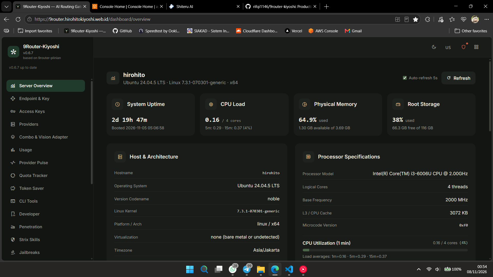

<div align="center">
  

  # 9Router-Kiyoshi

  AI routing gateway and local proxy for coding agents (Cline, OpenCode, Codex, Claude Code), based on [9Router Plinian](https://github.com/Azhar457/9router) (by Azhar457) and [9Router](https://github.com/decolua/9router) (by decolua). Includes Antigravity anti-ban protection with live `agy` binary fingerprint parity, Live Provider Pulse telemetry, real-time usage streaming, and an AMOLED dashboard.

  [](./CHANGELOG.md)
  [](./LICENSE)
  [Install](#installation) • [Features](#features-in-kiyoshi-edition) • [Antigravity Anti-Ban](#antigravity-anti-ban-protection) • [Pulse Telemetry](#live-provider-pulse-telemetry) • [Acknowledgments](#acknowledgments)

</div>

---

## Lineage and Project History

9Router-Kiyoshi is an independently maintained edition built on three projects:
1. **[9Router Plinian](https://github.com/Azhar457/9router)** (`Azhar457/9router`, v0.6.900): introduced the Go entry proxy, Red Team Toolkit, external payload registry, custom payload trees, `/v1/models` memoization, and lazy executor loading.
2. **[9Router](https://github.com/decolua/9router)** (`decolua/9router`): the original project providing the multi-provider routing engine, translator core, combo fallback, and Next.js dashboard.
3. **[OmniRoute](https://github.com/cheaper-inference/OmniRoute)** (`cheaper-inference/OmniRoute`): source of the multi-layer Antigravity header scrubbing, 429 guard, family-level cooldown, and pacing patches.

### Problems Addressed in This Fork
Coding agents (Cline, OpenCode, Codex) frequently send prompts of 100k to 380k tokens per turn. Under those workloads, standard gateways hit several concrete failure modes:
- Strict clients such as OpenCode and `@ai-sdk` close TCP sockets as soon as `data: [DONE]` arrives. Standard W3C streams trigger `cancel()` instead of `flush()`, leaving streams unfinalized with empty console summaries and 0-token usage records.
- Random project ID generation, stale hardcoded CLI versions, and extra transport or browser headers (`Connection`, `Transfer-Encoding: chunked`, `Accept`, `Accept-Language`, `Sec-Fetch-*`) trigger Google Cloud abuse heuristics and break upstream prompt cache keys.
- Upstream Gemini endpoints emit SSE payloads that fail non-streaming JSON parsers, returning empty strings or 502 Bad Gateway responses.
- Standard dashboards omit TTFT p50 and p95 distributions, error code breakdowns, and per-account health tracking, and require manual tab reloads to reflect completed token counts.

9Router-Kiyoshi handles these edge cases while keeping standard OpenAI (`/v1/*`) and Anthropic format compatibility.

---

## Features in Kiyoshi Edition

| Feature / Mod | What it does | Origin |
| --- | --- | --- |
| Live Provider Pulse (`/dashboard/pulse`) | Reads the last 50, 100, 200, or 500 requests from SQLite to report TTFT p50/p95, total roundtrip duration, cache-hit percentage, HTTP status distribution (`200`, `400`, `401`, `5xx`), and recent errors with browser-local timestamps. | Kiyoshi |
| Real-Time Usage & Details Streaming (`/dashboard/usage`) | Streams period-scoped usage stats, active/pending counts, chart refreshes, and SQLite `requestDetails` flush events over `/api/usage/stream` (`?period=` and `?channel=stats\|details`), updating KPI cards, charts, breakdown tables, and page-1 request details without reloading the browser tab. | Kiyoshi |
| 9-Layer Antigravity Armor | Anti-ban protection for Antigravity and Google Cloud: Layers 1 to 5 ported from OmniRoute (exact-wire header discipline, 429 refusal guard, 429 engine, family lockout, jittered pacing); Layers 6 to 9 built by Kiyoshi (authentic `aicode-consumers` project ID, 5m quota polling, live `agy` fingerprint captured from the installed binary, 120s first-token watchdog). | OmniRoute (L1-L5) + Kiyoshi (L6-L9) |
| Native `agy` Fingerprint From the Binary | Reads version, build (`cl`), User-Agent, header names, and header order from the installed `agy` binary (`~/.local/bin/agy` or `AGY_BIN`) instead of hardcoding them. Five seconds after the first Antigravity request and every 30 minutes after that (or on manual Sync), 9Router-Kiyoshi runs `agy update` and recaptures any new release into `DATA_DIR/agy-fingerprint.json` via an offline probe (throwaway profile, dummy token, local CONNECT recorder). Without `agy` on the host, requests fall back to the bundled snapshot (`1.5.14`, `cl=1026970498`), which stays frozen until the next build. The Antigravity provider page shows live sync status, a manual Sync button, and locks custom header overrides so stale User-Agents cannot be pinned; `scripts/agy-fingerprint-capture.mjs` exposes `--check` and `--print` for CLI inspection. | Kiyoshi |
| First-Token Watchdog | Caps the silent wait for the first usable chunk at 120 s measured from request start. Counts `content`, `reasoning_content`, `tool_calls`, and `finish_reason` as progress, ignores role-only and empty-content frames, and replays every buffered byte. On timeout the turn rotates to the next account or model instead of pinning the client. | Kiyoshi |
| Kiyoshi Motion System & Mobile Layout | Unified `motion/react` spring physics (`PageTransition`, `StaggerGrid`, `AnimatedNumber`, `ScrollReveal`, `useAutoAnimate` lists), `createPortal` modal/drawer rendering without CSS `filter` containing-block traps, responsive mobile header/drawer with 44px touch targets, sticky table columns, and mobile-optimized topology edges. | Kiyoshi |
| Dashboard Performance & Font Subsetting | Subset Material Symbols Outlined font to 249 used icons / 330 ligatures (`31.1 KiB` vs `3.87 MiB`) with `FILL` axis, coalesced `?summary=1` endpoints for `/api/settings` and `/api/providers`, ref-based `AnimatedNumber` updates, `en` i18n DOM-walk bypass, lazy-loaded charts/modals, and parallel async `/api/overview/specs`. | Kiyoshi |
| Stream Passthrough Sentinel Finalize | Detects `data: [DONE]` directly inside the passthrough transform loop and invokes `finalizeStream()` immediately, guaranteeing usage accounting and console logs even when strict clients abort on EOF. | Kiyoshi |
| Native Antigravity SSE-to-JSON & Gzip Bypass | `parseSSEToOpenAIResponse()` decodes native Gemini `{response:{candidates:[...]}}` SSE frames for non-streaming requests, and `createBypassResponse()` decompresses `gzip`/`deflate`/`br` responses on MITM-bypassed hosts (fixing 502 errors on `/v1/images/generations` with `ag/gemini-3.1-flash-image`). | Kiyoshi |
| Upstream-Accurate 429 Cooldown | Reads the real reset from the Cloud Code error body (`quotaResetTimeStamp`, `RetryInfo.retryDelay`, `"reset after XhYmZs"`) instead of guessing. A per-model image quota that Google says resets in 4h is locked for 4h, not 4 seconds (which retried a dead model thousands of times) and not 24h (the plan-level default). | Kiyoshi |
| Server Overview Dashboard (`/dashboard/overview`) | Sidebar system monitor showing CPU, RAM, disk, load averages, thermals, listening ports, network interfaces, Tailscale/Cloudflare status, and uptime. | Kiyoshi |
| Access Keys Injection Switch and Quotas | Master ON/OFF toggle per API key to selectively bypass system prompt steering and jailbreaks, plus daily/lifetime token quotas and key expiry. | Kiyoshi |
| AMOLED Black, Charcoal, and Paper Themes | AMOLED black (`#000000`), Charcoal, and Paper palettes. Badges and chips use solid design tokens (Forest Green `brand`, Warm Brass `brass`, Terracotta `clay`) without translucent overlays or glowing orb decorations. | Kiyoshi |
| Process-Isolated CLI Lifecycle | `killAllAppProcesses()` inspects `/proc/$pid/cwd` before terminating `next-server` instances, preventing 9router cleanups from killing unrelated Next.js applications on the same host. | Kiyoshi |
| CodeBuddy and WorkBuddy Identity | Passes through user and developer prompts without Tencent static identity overrides, adds UUIDv7 conversation header family, and provides fallback prompts for headless requests. | Kiyoshi |
| Red Team Toolkit | Global Injection, external jailbreak payload registry, transparency console, and custom payload repo-scan tree. | Plinian |
| Go Entry Proxy | Public port handled by a Go reverse proxy (client-IP stamping, TTFB logging, RTK sidecar). | Plinian |
| Memoized `/v1/models` & Lazy Executors | Fingerprinted `/v1/models` cache (888 ms to 13 ms median) publishing `thinking_levels`, plus on-demand async executor loading (`getExecutor`) reducing idle RSS. | Plinian |
| DPI-Resilient Transport & Socket Recovery | Configurable `X25519` ECDH curve, RFC 8305 happy-eyeballs, stale keep-alive fresh-socket replay, and `undici` 7.30.2 externalized in Next.js standalone builds. | Plinian |
| Synthetic, SenseNova Intl, and Model Catalog Updates | Added `syn` (`api.synthetic.new`), `sensenova-intl` (`token.sensenova.ai`), Claude Fable 5.2 and Haiku 5.5, Gemini 4 Carbon, GPT Image 2.6, and updated NVIDIA NIM models. | Plinian |
---

## Antigravity Anti-Ban Protection

This 9-layer defense system combines core anti-ban primitives ported from [OmniRoute](https://github.com/cheaper-inference/OmniRoute) (Layers 1 to 5) with native protocol parity, project preservation, and stall protection engineered in 9Router-Kiyoshi (Layers 6 to 9):

| Layer | Mechanism | What it does | Origin |
| --- | --- | --- | --- |
| 1 | Exact-Wire Header Discipline | Sends HTTP/1.1 over a raw TLS socket (direct or tunneled through `http://`, `https://`, and `socks4/4a/5/5h://` proxy pools with per-proxy socket isolation) with exactly the six headers the native Go client sends (`Host`, `User-Agent`, `Content-Length`, `Authorization`, `Content-Type`, `Accept-Encoding`) in captured order. No `Connection`, `Transfer-Encoding`, `Accept`, `Accept-Language`, or `Sec-Fetch-*`, which `fetch` and `undici` always add. | OmniRoute + Kiyoshi |
| 2 | 429 Refusal Guard | Caches prompts that trigger refusal 429s locally for 2 to 30 minutes, preventing agent hammer-loops from degrading account reputation. | OmniRoute |
| 3 | 429 Engine and Cooldown | Differentiates temporary rate limits from 24-hour quota exhaustions, triggering automated 24-hour cooldowns to prevent repeated retries against exhausted accounts. | OmniRoute |
| 4 | Family-Level Lockout | Isolates quota locks per model family (`gemini`, `claude`, `argon`). A Gemini quota exhaustion does not lock Claude models on the same account. | OmniRoute |
| 5 | Jittered Account Pacing | Enforces a 1200ms ±30% jitter pacing per account to eliminate parallel request bursts. | OmniRoute |
| 6 | Authentic Project ID Preservation | Preserves the authentic `aicode-consumers` project ID returned by `loadCodeAssist` and removes all random project ID generators that fragmented Google prompt caching and triggered bot detection. | Kiyoshi |
| 7 | Quota Polling Throttling | Reduces background quota polling from 30 seconds to 5 minutes per account, cutting automated polling traffic by 10x. | Kiyoshi |
| 8 | Official CLI (`agy`) Parity | Tracks the installed `agy` binary every 30 minutes via `agy update` and offline recapture (bundled fallback: `1.5.14`, `cl=1026970498`): dynamic User-Agent template, PKCE S256 with 43-character verifier and pinned redirect `https://antigravity.google/oauth-callback` (`auth/aicode` scope), `request.labels` telemetry (`cascade_id`, `trajectory_id`, `root_cascade_id`, `last_step_index`, `model_enum`), `{"metadata":{"ideType":"ANTIGRAVITY"}}` on `loadCodeAssist` (with connection proxy forwarding), `Go-http-client/1.1` on `oauth2/v2/userinfo`, `Accept-Encoding: gzip` on preflight lifecycle calls, locked custom header overrides, and large system prompt relocation out of `systemInstruction` (#9030). | Kiyoshi |
| 9 | First-Token Watchdog | Protects client turns from silent upstream stalls up to 120s from request start. Treats `content`, `reasoning_content`, and `tool_calls` as valid progress, ignores role-only frames, and rotates to the next account or model if the deadline expires. | Kiyoshi |

---

## Live Provider Pulse Telemetry

Accessible from the sidebar navigation at `/dashboard/pulse`:

- Toggle sample windows across the last 50, 100, 200, or 500 requests on the fly.
- Classify overall health by global success rate: Healthy at 90% or higher, Degraded from 70% to 89%, and Down below 70%. Latency is reported separately without downgrading a provider, since 100k to 380k token agent loops require 4 to 8s TTFT.
- Break down metrics per provider (request counts, success rate, TTFT p50/p95, total duration p50, cache-hit percentage, input/output tokens, localized last-seen time), per model (such as `gemini-3.8-flash-high` vs `claude-sonnet-4-6`), and per account or key via SQLite `LEFT JOIN providerConnections`.
- Inspect HTTP status distribution (`200 OK`, `400 Bad Request`, `401 Unauthorized`, `500 Upstream Error`, `unknown`), recent upstream error previews, and a TTFT p50 vs p95 latency area chart.

---

## Installation

### Prerequisites
- Node.js `>= 20.18.1` minimum engine: Node.js 20 recommended for compiling Next.js 16 without SWC bus errors, and Node.js 22.5 or higher (Node 24 recommended) at runtime to activate the native C++ `node:sqlite` driver.
- Git

### Recommended for Antigravity: Install the Official `agy` CLI

If you route traffic through Antigravity, install Google's official `agy` CLI on the same host so 9Router-Kiyoshi can keep its client fingerprint current automatically.

**macOS / Linux:**
```bash
curl -fsSL https://antigravity.google/cli/install.sh | bash
agy --version
```

**Windows (PowerShell):**
```powershell
irm https://antigravity.google/cli/install.ps1 | iex
agy --version
```

- Without `agy` on the host, 9Router-Kiyoshi falls back to the bundled snapshot (`open-sse/config/agy-fingerprint.default.json`, currently `1.5.14`, `cl=1026970498`). Outbound requests still use the 6-header HTTP/1.1 wire format, but the version and `cl` build number stay frozen until you pull a newer build.
- With `agy` installed, 9Router-Kiyoshi runs `agy update` 5 seconds after the first Antigravity request and every 30 minutes after that (or immediately when you click Sync on the Antigravity provider page). When `agy --version` moves past the stored snapshot, an offline probe spawns `agy -p` with a throwaway dummy-token profile behind a local CONNECT recorder and writes the updated `cl`, User-Agent template, and header order to `DATA_DIR/agy-fingerprint.json`.
- You do not need to sign into `agy` on the server. The probe uses a dummy token and never sends real credentials to Google.

Environment overrides:
- `AGY_BIN`: path to the `agy` binary when installed outside `~/.local/bin/agy` (required on Windows, where the installer places `agy.exe` at `C:\Users\<username>\AppData\Local\agy\bin\agy.exe`).
- `ANTIGRAVITY_AGY_UPDATE=0`: skip automatic `agy update` checks while keeping local version detection and recapture.
- `ANTIGRAVITY_FINGERPRINT_CAPTURE=0`: disable background probing and recapture.

### Step 1: Clone Repository
```bash
git clone https://github.com/rifqi1146/9router-kiyoshi.git
cd 9router-kiyoshi
```

### Step 2: Environment Configuration
```bash
cp .env.example .env
```
*(Optional: configure port, hostname, or override `INITIAL_PASSWORD` (default: `123456`) and `JWT_SECRET` in `.env`)*

### Step 3: Install Dependencies and Build
```bash
# Install dependencies
npm install

# Build Next.js dashboard
npm run build

# Build CLI package
npm run cli:pack
```

### Step 4: Start the Server

#### Option A: Run via npm (Recommended for Servers / VPS)
```bash
PORT=20128 HOSTNAME=0.0.0.0 NEXT_PUBLIC_BASE_URL=http://localhost:20128 npm run start
```

#### Option B: Install as Global CLI Launcher
```bash
cd cli
npm install -g .

# Launch background daemon
9router-kiyoshi -p 20128 --host 0.0.0.0 --skip-update --no-browser
```

Common CLI flags:
```bash
9router-kiyoshi --port 20128     # port (default: 20128)
9router-kiyoshi --host 0.0.0.0   # bind address
9router-kiyoshi --no-browser     # disable opening browser automatically
9router-kiyoshi --skip-update    # bypass startup version check
```

#### Option C: Configure Remote CLI Tools (`npx 9router connect`)
```bash
# Configure Claude Code tiers against a running gateway
npx 9router connect http://<server-host>:20128 --tools claude \
  --fable cc/claude-fable-5-2 --opus cc/claude-opus-5-5 \
  --sonnet cc/claude-sonnet-5-5 --haiku cc/claude-haiku-4-5-20251001

# Configure non-Claude tools
npx 9router connect http://<server-host>:20128 --tools codex,opencode,kilo --model ocg/deepseek-flash
```

Open the dashboard at `http://localhost:20128/dashboard` (default login password: `123456`).

---

## Request Lifecycle and Architecture

```
Cline / OpenCode / Codex / Claude Code
        │  POST http://localhost:20128/v1/chat/completions
        ↓
┌────────────────────────────────────────────────────────┐
│ 9Router-Kiyoshi (Go Reverse Proxy + Next.js Server)    │
│  • Custom Server: socket IP extraction & cf-ip trust   │
│  • RTK Pre-Translate Token Saver (cursor tool_results) │
│  • Translator Engine (OpenAI ↔ Claude ↔ Gemini ↔ ...)  │
│  • 9-Layer Antigravity Armor & Exact-Wire agy Parity   │
│  • Combo Fallback & Round-Robin Load Balancer          │
│  • Stream Passthrough Sentinel Finalizer               │
│  • RequestDetails & Live SSE Usage Stream (SQLite)     │
└───────┬────────────────────────────────────────────────┘
        │
        ├─► Antigravity (Google Cloud / Gemini 3.8 & 4)
        ├─► CodeBuddy / WorkBuddy (DeepSeek / Qwen)
        ├─► Claude / Kiro / Codex
        └─► OpenCode Free / Synthetic / SenseNova Intl / Custom Endpoints
```

Full architecture specifications: [`docs/ARCHITECTURE.md`](./docs/ARCHITECTURE.md) and [`agent.md`](./agent.md).

---

## Data and Persistence

9Router-Kiyoshi persists state to SQLite (`src/lib/db/`) using a fallback adapter chain (`driver.js`):
`bun:sqlite` → `better-sqlite3` → `node:sqlite` (Node 22.5+, default) → `sql.js` (pure JS fallback).
During Next.js build phases (`NEXT_PHASE`), `driver.js` and `initOutboundProxy.js` isolate builds to an in-memory `sql.js` instance, and `sqljsAdapter.js` refuses to overwrite a database with an active `-wal` file so builds never corrupt a live `node:sqlite` database.
| Platform | Default Path |
| --- | --- |
| Linux / macOS | `~/.9router/db/data.sqlite` |
| Windows | `%APPDATA%\9router\db\data.sqlite` |
| Custom | Set `DATA_DIR` environment variable |

Security-relevant environment variables (see `.env.example`):
- `JWT_SECRET`: Dashboard session cookie signing secret.
- `INITIAL_PASSWORD`: Initial dashboard login password (default `123456`, override immediately).
- `API_KEY_SECRET`: Encryption key for provider credentials.
- `MACHINE_ID_SALT`: Salt for machine ID fingerprinting.

---

## Documentation

- [`agent.md`](./agent.md): modification log, build procedures, and deployment rules.
- [`CHANGELOG.md`](./CHANGELOG.md): version history and release notes.
- [`docs/ARCHITECTURE.md`](./docs/ARCHITECTURE.md): system architecture, request lifecycle, and storage map.
- [`open-sse/AGENTS.md`](./open-sse/AGENTS.md): routing and translation engine conventions.

---

## Acknowledgments

9Router-Kiyoshi stands on the work of:

- [Azhar457](https://github.com/Azhar457) and [9Router Plinian](https://github.com/Azhar457/9router): the upstream fork providing the Go entry proxy, Red Team Toolkit, custom payloads scan tree, and provider curation.
- [OmniRoute](https://github.com/cheaper-inference/OmniRoute): creators of Layers 1 to 5 of the Antigravity anti-ban defense system (header scrubbing, 429 refusal guard, 429 engine, family lockout, and jittered pacing).
- [decolua](https://github.com/decolua) and all contributors to [9Router](https://github.com/decolua/9router): the foundational AI routing gateway project.
- [CLIProxyAPI](https://github.com/1rgs/CLIProxyAPI): original Go implementation that inspired 9Router.
- [RTK](https://github.com/rtk-ai/rtk), [Headroom](https://github.com/chopratejas/headroom), [Caveman](https://github.com/JuliusBrussee/caveman), and [Ponytail](https://github.com/DietrichGebert/ponytail): token-saving compression utilities.
- Authors of the AI-Jailbreaks and BlackFriday-GPTs-Prompts research collections.

---

## License

MIT (see [LICENSE](./LICENSE)).
